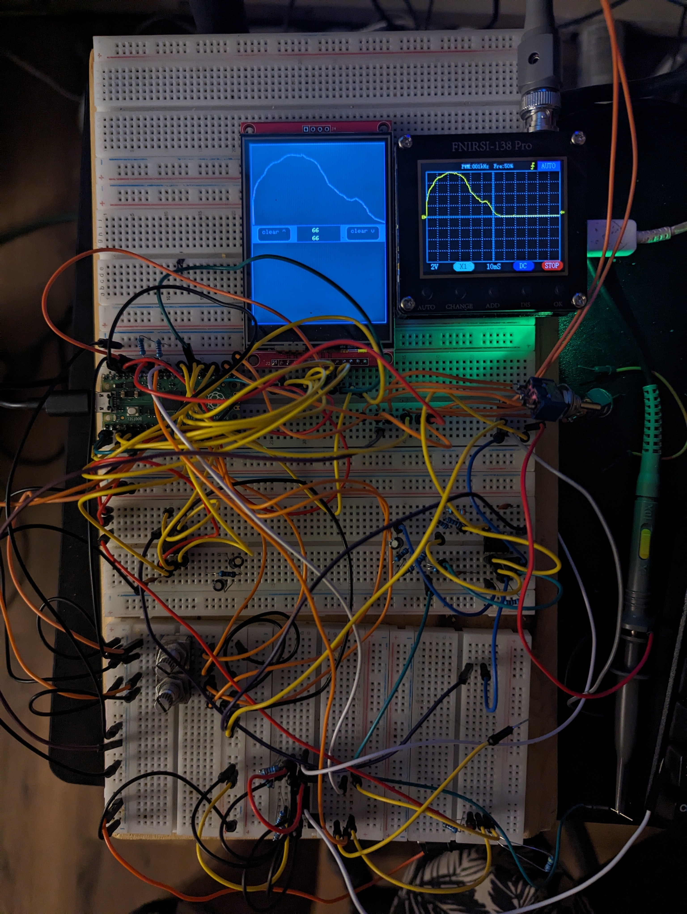

# env-two (silver-rotary)

experimental dual envelope generator. 

analog triggers in and analog voltage out.  

selectable modes: loop, trigger and gate.

minimum duration: 6ms

Using the MCP4822, PC817 optocouplers, LM358 op amp and some filtering.  duration set by rotary encoders with display value in milliseconds.

Kicad Schematic

